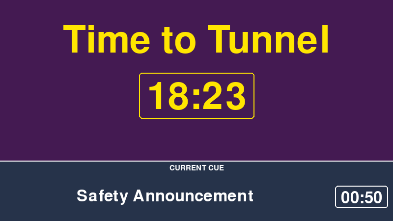
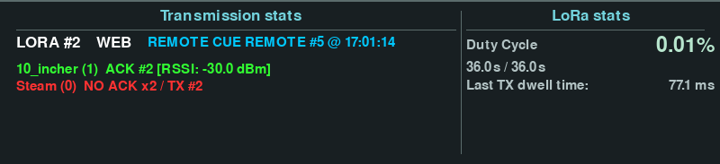

# LoRaQ - Long Range Wireless Cue Display System (v1.0)

**LoRaQ** is an open-source wireless cue display system built for live theatre, festivals, and event production. It relays live cue text, countdown timers, and visual/audio alerts from show control software (such as QLab or SCS) to remote operators and crew over long-range LoRa radio.

Originally built to solve the communications challenge of coordinating a live immersive theatrical production along a multi-station heritage railway, LoRaQ is designed specifically for environments where standard Wi-Fi is not reliable enough and laying cables is impossible or cost-prohibitive.

---

## How It Works

1. **Host/Transmitter:** A Mac or PC running your show control software (e.g. QLab) connects to a USB LoRa dongle. The `LoRaQ-transmitter` daemon listens for incoming OSC messages over local loopback or the local network.
2. **LoRa Transmission:** Cue payloads are broadcast over sub-GHz LoRa radio bands (868 MHz / 915 MHz).
3. **Receiver Stations:** Standalone Raspberry Pis (such as a Pi Zero) fitted with a LoRa Hat pick up the signal and drive an HDMI monitor with low-latency text, timers, and alerts.
4. **Reliability & Telemetry:** Receivers send an automatic acknowledgment (ACK) in their assigned time slot, giving the show operator live signal strength (RSSI) and delivery confirmation for each monitored station.
5. **Web Viewer (Optional Fallback):** Any station can also push live cues to a lightweight web service so crew can check cue status on a mobile browser where radio hardware cannot be installed.

---

## Hardware Requirements

### Transmitter (Host Station)
- Mac, Windows, or Linux machine running show control software.
- SX1262-based USB LoRa transceiver (e.g., **EByte E22-900T22U** USB dongle).

### Receiver (Stage Station)
- **Raspberry Pi** (Pi Zero, or any other Pi model) running DietPi or Raspberry Pi OS Lite.
- **Waveshare SX1262 LoRa Hat**.
- Any standard HDMI display or monitor, with integral speakers for audio alerts.

---

## Quick OSC Example

Send raw OSC messages to the LoRaQ transmitter machine on port `53070` (configurable in `loraq.ini`):

| Action | OSC Path | Arguments / Example | Notes |
| :--- | :--- | :--- | :--- |
| **Main Cue (Area 1)** | `/display` | `"STANDBY CUE 12" 1 yellow` | Primary display zone with auto-scaling text |
| **Cue with Timer & Alert** | `/display` | `"GO SCENE 2" 1 green 01:30 2` | `01:30` countdown timer, Alert ID `2` (Flash + Buzzer) |
| **Status Cue (Area 2)** | `/display` | `"CUE 42 ACTIVE" 2 white 00:45` | Lower sliding status panel & independent timer |
| **Trigger Alert Only** | `/alert` | `6` | Integer `0`–`7` (e.g. `6`: Flash + Double-Beep); leaves text intact |
| **Clear Display Zone** | `/clear` | `2` *(or `1`, or no args for both)* | Clears Area 1, slides down Area 2, or clears both zones |
| **Arm Remote Trigger** | `/oscstandby` | `/workspace/1/go 12` | Arms transmitter to forward OSC when triggered over LoRa |
| **Fire Remote Trigger** | `/oscsend` | *(no arguments)* | Broadcasts trigger over LoRa to release standing-by cues |

> **Timer Format:** Timers require `MM:SS` format (e.g. `01:30` or `00:45`).  
> **Colours:** Supported colours are `white`, `red`, `green`, `yellow`, `blue`, and `orange` (or shorthand `W, R, G, Y, B, O`).  
> **Alert IDs:** `0`: None, `1`: Flash, `2`: Flash + Buzzer, `3`: Buzzer, `4`: Flash + Beep, `5`: Beep, `6`: Flash + Double-Beep, `7`: Double-Beep.
---

## Key Features

- **Dual Visual Display Zones:**
  * **Area 1 (Main Action):** Auto-scaling primary text supporting large countdown timers and high-contrast strobe flashes.
  * **Area 2 (Status Panel):** Sliding lower panel displaying current/upcoming cue numbers and an independent secondary timer.
- **Bi-directional ACKs & RSSI:** Live preview monitor tracks signal quality (RSSI) and ACK confirmation for every provisioned receiver ID.
- **OSC Forwarding:** Cues can be triggered on remote computers via LoRa using two-stage standby/trigger commands.
- **Boot & Fault Telemetry:** Receivers broadcast an `ONLINE` burst on startup; unexpected re-announcements alert the operator to potential issues.
- **Built-in RF Range Test:** Test mode reporting signal strength for site surveys during setup.

---

## Setup & Documentation

- **[Transmitter Setup Guide](docs/transmitter_setup.md):** Dependencies, station configuration, OSC network settings, and startup.
- **[Receiver Setup Guide](docs/receiver_setup.md):** DietPi image setup, auto-boot configuration, and display output tuning.
- **[LoRa Adapter Configuration](docs/lora_adapter_config.md):** Frequency, spreading factor, and bandwidth setup for SX1262 hardware.
- **[Communication Protocol](docs/protocol.md):** LoRa frame format, cue records, acknowledgments, and protocol behavior.
- **[Web Viewer Push Setup](docs/web_push.md):** Deploying the web browser viewer.
- **[System Operations Manual](docs/system_operation.md):** End-to-end operation guide.

---

## Regional RF Airtime & Duty Cycle Compliance

LoRa uses sub-GHz radio bands subject to local regulations. Permitted frequencies, transmit power, antenna gain, duty cycle and channel-access requirements depend on the country and the specific band in use. Check your regulator's current requirements before operating the system; the supplied settings are not a universal compliant configuration.

LoRaQ displays estimated duty cycle and frame airtime in the console and transmitter preview. The `duty_cycle_limit_percent` and `max_dwell_time` settings in `loraq.ini` control these indications only: **LoRaQ does not enforce regulatory limits or guarantee compliance.**

---

## License & Trademarks

This project is licensed under the **GNU General Public License v3.0 (GPLv3)**. See [LICENSE](LICENSE) for details.

*LoRa® is a registered trademark of Semtech Corporation. LoRaQ is an independent open-source project and is not affiliated with or endorsed by Semtech Corporation.*