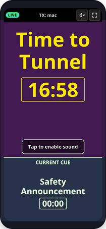

# LoRaQ Web Display

The optional web display lets crew follow cues on a phone, tablet or computer using a private browser link. It shows both display areas, countdowns, flashes and optional alert sounds.



At least one LoRaQ transmitter or receiver needs an internet connection to send cues to your web server. Viewers also need internet access. The LoRa radio system works independently of web push cues.

## What you need

* Web hosting with **Apache 2.4 and PHP 8.x**, with URL rewriting and `.htaccess` files enabled. Ask your hosting provider if unsure.
* **HTTPS** enabled for your site, to protect the private links and push tokens.
* Access to upload files, edit a PHP configuration file and set folder permissions, through your hosting control panel or FTP client.

No database or additional software installation is needed on the server.

## 1. Upload the files

Upload the complete [web/loraq](../web/loraq/) folder to your web space, for example as `public_html/loraq`. Include the hidden `.htaccess` files; some FTP clients hide them.

Your base URL will then be something like `https://example.com/loraq`.

## 2. Configure the server

In the uploaded `loraq/app` folder, copy `config.sample.php` to `config.php` and edit these settings:

| Setting | What to enter |
|---|---|
| `data_dir` | A folder where PHP can save the display state. See permissions below. |
| `title` | Your show name, displayed at the top of the viewer. |
| `view_key` | A random private key, **20-128 characters** long. This becomes part of the viewer link. |
| `push_tokens` | A separate random token for each device sending cues, **16-128 characters** long. Names such as `tx-main` identify the device in the viewer. Remove any unused sample entries. |

Replace all `CHANGE-ME` values with your own random value. Keys and tokens may contain letters, digits, underscores and hyphens only. Use different values for the viewer key and each push token.

### Folder permissions

Prefer a `data_dir` outside the public web folder, such as `/home/USER/loraq-data`. Create that folder and set its ownership/permissions so PHP can read and write it. 

Alternatively, leave the supplied `data_dir` setting to use `loraq/app/data`; the included `.htaccess` protects the `app` folder. **Only the data folder needs to be writable by PHP, not the whole application.** Do not make folders writable by everyone.

Before sharing the viewer, open `https://example.com/loraq/app/config.php` and confirm it returns **403 Forbidden**. 

## 3. Connect LoRaQ to the server

On each device that will send cues to the web display, edit the existing `[web_push]` section in `loraq.ini`:

```ini
[web_push]
enabled = true
url = https://example.com/loraq
token = <this device's push token>
```

Use the base URL, **not** the private viewer link, and replace the token placeholder with the matching value from `config.php`. Leave the other web-push settings at their supplied values, then restart the transmitter or receiver application.

Start with the main transmitter. You can also enable a receiver, ideally using a different internet connection, for redundancy. Copies from multiple devices are merged automatically. On transmitters, `push_remote = true` also forwards cues heard from other transmitters over LoRa.

## 4. Open and share the viewer

Open `https://example.com/loraq/v/<view_key>`, replacing `<view_key>` with your configured value. Send a normal display cue from LoRaQ and check that it appears. Range-test pings do not appear in the web display.

The viewer link is the password: share it only with people who should see the cues. To revoke existing links, change `view_key` in `config.php` and share the new URL. To revoke a device's ability to send cues, remove its push token.

## Using the display

* **Sound:** Tap to enable sound when prompted, or use the speaker button. Browsers require interaction before playing alerts.
* **Full screen:** Use the full-screen button or double-click/double-tap the display. Where supported, the viewer also requests that the screen stays awake.
* **Phone home screen:** On Android, use Chrome's **Install** or **Add to Home screen** option. On iPhone, open the link in Safari and choose **Share > Add to Home Screen**, enabling **Open as Web App** if offered.
* **Connection status:** `LIVE` means connected; `RECONNECTING` or `OFFLINE` means the viewer has lost contact with the server. `NO SIGNAL` means the server has not heard from a LoRaQ device for two minutes.
* **Internet interruptions:** Devices retry queued cues automatically. Timers account for delivery delays, but stale flashes and sounds are not replayed. While offline, the viewer keeps counting down existing timers but cannot receive new cues.

## Troubleshooting

| Problem | What to check |
|---|---|
| Viewer link gives 404 or "not valid" | Check the URL and `view_key`. Replace all `CHANGE-ME` placeholders and use the required key length. |
| Viewer says `NO SIGNAL` | Check the sending device's internet connection, `[web_push] enabled` setting and application logs. Restart the application after editing its configuration. |
| Device reports HTTP 401 | Its push token must exactly match an entry in `config.php`. |
| Device reports HTTP 500 | Check that PHP can write to `data_dir` and that `config.php` has no editing errors. Ask the host to check the PHP error log. |
| Device reports a certificate error | Check the site's HTTPS certificate and the sending device's date/time. On a Pi, allow time for its clock to synchronise after boot. |
| All viewer links give 404 | Check that hidden `.htaccess` files were uploaded and ask the host to enable URL rewriting. |

To host another show, add another entry under `shows` in `config.php`, with its own title, viewer key and push tokens.
